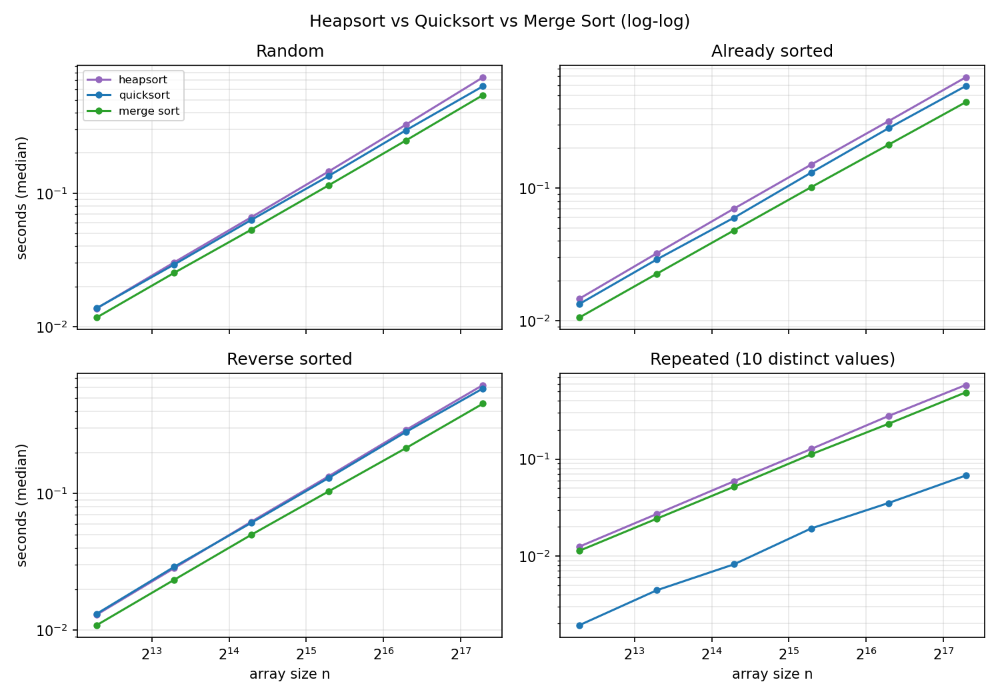
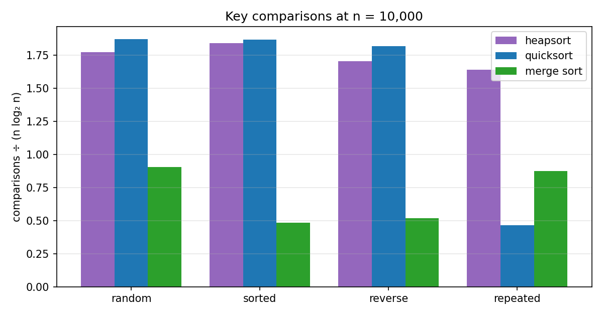
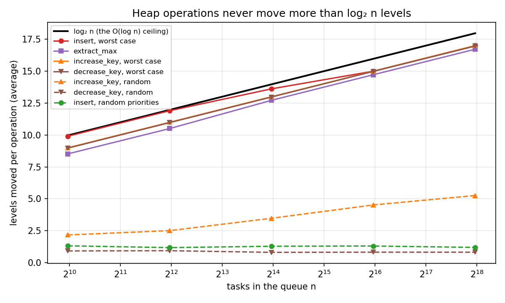
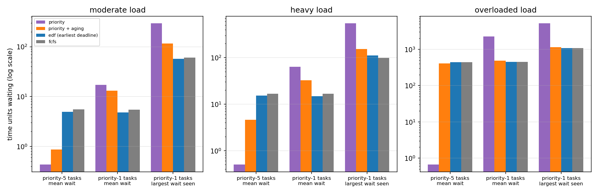
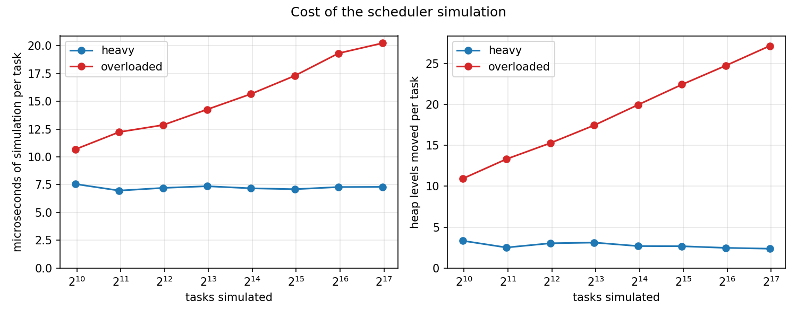
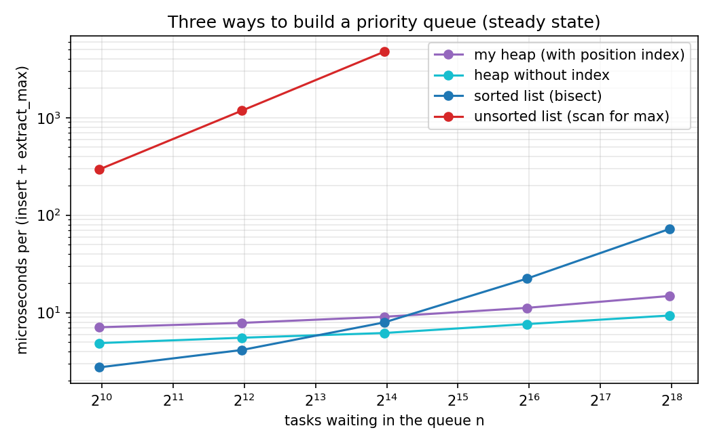

# Assignment 4: Heap Data Structures: Implementation, Analysis, and Applications

Samrat Kafle · MSCS-532 Algorithms and Data Structures · University of the Cumberlands · November 9, 2026

This report has two parts. Part 1 is Heapsort: the implementation, its time and space analysis, and a timing comparison against Quicksort and Merge Sort. Part 2 is a priority queue built on a binary max-heap, plus a task scheduler simulation that uses it. Everything can be reproduced with the scripts in this repository (see `README.md`). Every number in the tables and text below comes from the files in `results/` (each experiment script writes its own file); numbers that come from the unit tests or from `results/mutation_check.txt` are labelled as such.

## Summary

- **Heapsort is O(n log n) for every input.** Building the heap took 1.87 to 1.88 comparisons per element (the bound is 2n), and the extraction phase took 1.5 to 1.7 times n·log₂ n comparisons for n from 1,000 to 100,000, which is under the bound of 2·n·log₂ n. It sorts in place with O(1) extra memory.
- **It was the slowest of the three in pure Python.** On random input at n = 160,000 it took 0.737 s, against 0.632 s for Quicksort and 0.543 s for Merge Sort. It makes about twice as many comparisons as Merge Sort (1.77 against 0.91 times n·log₂ n at n = 10,000).
- **Its running time depends little on input order.** Sorted, reverse-sorted and random input at n = 160,000 took 0.685, 0.622 and 0.737 s (within 19%). Its O(n log n) worst case holds for every input, which a first-element Quicksort cannot promise. The randomized Quicksort here was even less sensitive in practice (within 8%) but only has an expected-time guarantee, and heapsort pays for its guarantee with a higher constant.
- **Every priority-queue operation moves a task at most log₂ n levels** (log₂ n = 18 at 256,000 tasks). The worst cases I forced hit exactly the height of the tree: 17.0 levels at n = 256,000. A random insert, however, moved only about 1.2 to 1.3 levels on average, whatever the size of the queue.
- **A heap beats simpler queues only once the queue is long.** With fewer than about 16,000 waiting tasks, a sorted list was faster than my heap in my pure-Python tests (a plain heap without the position index that `increase_key` needs was already faster at 16,000). At 256,000 waiting tasks my heap was 4.9 times faster than the sorted list (14.8 against 72.0 microseconds per insert and extract).
- **Scheduling results:** under priority scheduling the highest-priority tasks waited about 0.5 time units on average, but the lowest-priority ones waited 17 (moderate load) to 2,264 (overloaded) on average. Aging cut the longest wait by 60 to 78% but did not lower the overall mean wait (17.26 against 17.16 at heavy load): it moves waiting from the lowest class onto the others, and under overload it made the simulation up to 10 times slower. Earliest-deadline-first spread the lateness evenly, and that made it *worse* than priority scheduling at heavy load (49% against 31% of deadlines missed, and 54% against 32% when I made the deadline slack independent of burst time).

## 0. How the experiments were run

- **Machine:** AMD Ryzen 7 3700X, Windows 11, Python 3.13.9 (`results/environment.txt`), one core.
- **Timing:** `time.perf_counter()`, median of 5 runs (3 for the queue comparison in 2.5). Arrays are copied before the clock starts, and every sort result is checked against `sorted()`.
- **Inputs:** fixed random seeds. Four kinds of array: *random* (distinct integers), *sorted*, *reverse-sorted*, and *repeated* (integers from 0 to 9, so each value appears about n/10 times).
- **Fair comparison:** all three sorts are plain Python and none of them calls `sorted()` or `list.sort()`.
- **A caution about Python:** each step of a loop costs far more than it would in a compiled language. The shapes of the curves and the ratios matter more than the absolute times.

---

## Part 1: Heapsort

### 1.1 Implementation

The code is in `heapsort.py`. The array is read as a binary tree stored level by level: the element at index i has its parent at (i − 1) // 2 and its children at 2i + 1 and 2i + 2. A **max-heap** is an array where each element is at least as large as its children, so the largest element is at index 0.

- `max_heapify(a, i, heap_size)` lets `a[i]` sink down until the subtree under it is a max-heap again. It assumes the two subtrees below it already are. Only `a[0 .. heap_size − 1]` counts as the heap, so the sorted tail of the array is left alone. It is a loop, not a recursive call.
- `build_max_heap(a)` calls `max_heapify` on every non-leaf element, from index n // 2 − 1 down to 0. Going backwards means each call finds two subtrees that are already heaps.
- `heapsort(a)` builds the heap, then repeats: swap the root (the largest) with the last element of the heap, shrink the heap by one, and repair the root with `max_heapify`. The largest elements pile up at the end of the array in order.

The algorithm is Williams (1964), and the linear-time bottom-up way of building the heap is Floyd (1964). I followed the structure in Chapter 6 of Cormen et al. (2022).

Testing (`test_heapsort.py`): the edge cases (empty, one element, two elements, all equal, sorted, reverse-sorted, few distinct values, negatives, floats and strings), 300 random arrays against `sorted()`, a 20,000-element sorted and reverse-sorted input (to prove there is no recursion), that `build_max_heap` really creates a heap, that `max_heapify` respects `heap_size`, and comparison-count checks. `mutation_check.py` also breaks the code on purpose in 33 ways (skipping the last pass, ignoring `heap_size`, comparing the wrong way round, a heap-move counter that never counts, a scheduler that accepts float times again, and so on) and checks that the tests fail. All 33 are caught (`results/mutation_check.txt`). A reviewer found eight of those bugs slipping past my first test suite (never-counted moves, an `is_valid()` that always says True, a bulk build that skips a node, and others), so I added tests for them.

### 1.2 Analysis

**What one `max_heapify` costs.** Each loop step does at most 2 comparisons (the left child with the parent, then the right child with the larger of those two) and moves one level down. A node at height h can move at most h levels, so the cost is O(h), which is at most O(log n).

**Building the heap is O(n), not O(n log n).** There are at most ⌈n / 2^(h+1)⌉ nodes at height h, and each costs O(h) to heapify. So the total is

> Σ_{h=0}^{⌊log₂ n⌋} ⌈n / 2^(h+1)⌉ · O(h) = O(n · Σ_{h≥0} h / 2^h) = O(n)

because Σ h / 2^h = 2. This is the reason for starting from the bottom. Most nodes are near the leaves and cost almost nothing. Measured: the build used 1.87 to 1.88 comparisons per element for n from 1,000 to 100,000, consistent with the bound of about 2n that the sum gives (the ceilings in the sum allow 2n plus lower-order terms, which I did not work out exactly; table in 1.3).

**The extraction loop is O(n log n).** It runs n − 1 times. In the iteration that leaves a heap of k elements (k runs from n − 1 down to 1), `max_heapify` is called on the root and moves at most ⌊log₂ k⌋ levels, with at most 2 comparisons per level. So the total number of comparisons is at most

> 2 · Σ_{k=1}^{n−1} ⌊log₂ k⌋ ≤ 2 n log₂ n

Together with the build phase, heapsort uses at most 2n + 2n log₂ n comparisons.

**Worst, average and best case.**

- **Worst case: Θ(n log n).** The upper bound is the 2n log₂ n above. For the lower bound, any comparison sort needs at least log₂(n!) = n log₂ n − O(n) comparisons on some input (a decision tree with n! leaves has height at least log₂ n!), and heapsort is a comparison sort.
- **Average case: Θ(n log n).** The same decision-tree argument bounds the *average* leaf depth from below by log₂ n!, so the average over all orderings is Ω(n log n). The worst-case upper bound is an upper bound for the average. I measured about 1.77 · n·log₂ n comparisons on random input.
- **Best case.** O(n log n) still holds as an upper bound, which is the "in all cases" part of the question. Why does it hold for every input? The build phase is O(n) whatever the data looks like. The extraction loop always runs exactly n − 1 times, and each pass costs at most O(log n) because the height of the heap does not depend on the data. Nothing in heapsort's control flow depends on the input order except where a sift-down happens to stop early, and stopping early can only make it cheaper. Compare Quicksort, where the sizes of the partitions depend on the input.
  - It is **not** Θ(n log n) for *every* input, though. If all keys are equal, no element ever moves, each `max_heapify` stops after its first level, and heapsort does only about 3n comparisons. A test checks this (`≤ 3n`), and the count at n = 10,000 is 29,994 comparisons (`results/sorts_comparisons.csv`).
  - For *distinct* keys I could not find an input that makes heapsort much cheaper. The comparison counts for sorted, reverse-sorted and random input at n = 10,000 were 244,460, 226,682 and 235,312, within 8% of each other. So I believe the best case is also Θ(n log n) for distinct keys, but I have not proved a lower bound for it.

**Space and overheads.**

- **Space: O(1) extra.** Everything happens inside the original list, and `max_heapify` is a loop, so there is no recursion stack either. Quicksort needs O(log n) of stack and Merge Sort needs an O(n) auxiliary array.
- **Not stable.** Equal keys can change their order. Sorting three items with equal keys `2a, 2b, 2c` gives `2b, 2c, 2a`. Merge Sort is stable.
- **About twice the comparisons of Merge Sort.** Each level of a sift-down costs two comparisons, and the element that is sifted down (the former last leaf) usually sinks almost to the bottom again. Merge Sort uses about n·log₂ n − n.
- **Poor memory locality.** A sift-down jumps between index i and 2i + 1, which are far apart in memory for the large heaps near the root. I suspect this, and not extra comparisons alone, is why heapsort's time per n·log₂ n creeps upward as n grows (1.3 below), but I did not test it.

### 1.3 Empirical comparison with Quicksort and Merge Sort

The Quicksort here is the randomized, three-way-partition version from Assignment 3 (`other_sorts.py`). Merge Sort is a top-down, stable version with one shared buffer. Times are for n from 5,000 to 160,000 (`benchmark_sorts.py`, `results/sorts_times.csv`).



**Time at n = 160,000 (seconds):**

| input | heapsort | quicksort | merge sort | heapsort ÷ merge sort | heapsort ÷ quicksort |
|---|---|---|---|---|---|
| random | 0.737 | 0.632 | 0.543 | 1.36× | 1.17× |
| sorted | 0.685 | 0.589 | 0.445 | 1.54× | 1.16× |
| reverse-sorted | 0.622 | 0.587 | 0.455 | 1.37× | 1.06× |
| repeated (10 values) | 0.582 | 0.068 | 0.489 | 1.19× | 8.61× |

**Key comparisons at n = 10,000** (in brackets: comparisons ÷ n·log₂ n; `results/sorts_comparisons.csv`):

| input | heapsort | quicksort | merge sort |
|---|---|---|---|
| random | 235,312 (1.77) | 248,731 (1.87) | 120,433 (0.91) |
| sorted | 244,460 (1.84) | 248,101 (1.87) | 64,608 (0.49) |
| reverse-sorted | 226,682 (1.71) | 241,285 (1.82) | 69,008 (0.52) |
| repeated | 217,882 (1.64) | 62,028 (0.47) | 116,206 (0.87) |



**Heapsort's two phases** (random input, counted with the key-wrapping class in `counting.py`; `results/heapsort_phases.csv`):

| n | build comparisons | build ÷ n | extraction comparisons | extraction ÷ (n·log₂ n) | total ÷ (n·log₂ n) |
|---|---|---|---|---|---|
| 1,000 | 1,874 | 1.874 | 15,030 | 1.508 | 1.696 |
| 10,000 | 18,763 | 1.876 | 216,549 | 1.630 | 1.771 |
| 100,000 | 188,149 | 1.881 | 2,831,454 | 1.705 | 1.818 |

**How the results relate to the analysis**

1. **All three grow like n log n.** From n = 5,000 to n = 160,000 the growth exponents (k in time ≈ c·nᵏ) were 1.15 for heapsort, 1.10 for quicksort and 1.11 for merge sort on random input. A clean n log n gives about 1.10 over that range, and n² would give 2. Quicksort and Merge Sort sit right on n log n, and heapsort is a little above it (see point 5).
2. **Build is linear and extraction dominates, as the analysis says.** The build phase used about 1.88 comparisons per element, under the 2n bound, and that figure barely changed as n grew 100 times. The extraction phase used 1.51, 1.63 and 1.70 times n·log₂ n. It rises toward the bound of 2 with n, because the n log n bound uses the full height of the heap for every pass, while the heap shrinks as the sort goes on.
3. **Input order hardly matters to heapsort.** At n = 160,000 the times for random, sorted and reverse-sorted input were within 19% of each other (0.737, 0.685, 0.622 s), and the comparison counts at n = 10,000 within 8% (see above). That is the property the analysis predicted, and it is the reason to use heapsort: the running time has a guarantee. Randomized Quicksort was just as insensitive here (within 8%, against 19% for heapsort), but its guarantee is only about *expected* time, while a deterministic Quicksort has quadratic worst cases and heapsort's O(n log n) holds for every input.
4. **Heapsort lost to both on speed.** At n = 160,000 it was 6 to 17% slower than Quicksort and 36 to 54% slower than Merge Sort on the three distinct-key inputs (at n = 5,000 heapsort and Quicksort were within about 1% on random and reverse-sorted input, so the gap grows with n). Part of the reason is comparisons: it did about 1.77 · n log₂ n against 0.91 for Merge Sort on random input. Merge sort on sorted input did only 0.49, because merging two already-sorted halves takes about half as many comparisons as merging random ones. The rest I would guess is memory access, but I did not test it.
5. **Heapsort's time per n·log₂ n drifts upward; the others stay flat.** For random input it went from 0.223 microseconds at n = 5,000 to 0.266 at n = 160,000 (+19%; on the other three inputs only +3.5 to +6.3%). Quicksort went from 0.224 to 0.229 and Merge Sort from 0.191 to 0.196. I think this is the cache effect mentioned above, but this is a guess. The comparison counts alone cannot explain it, because the ratio of comparisons to n·log₂ n only rose from 1.70 (n = 1,000) to 1.82 (n = 100,000), which is +7% over a wider range of sizes than the timing runs covered.
6. **Repeated values favour the three-way Quicksort by a lot** (8.6 times faster than heapsort at n = 160,000; at n = 10,000 it needed only 0.47 · n log₂ n comparisons). Heapsort and Merge Sort hardly notice duplicates. Heapsort used 1.64 against 1.77 times n·log₂ n comparisons, only 7% fewer than on distinct keys.
7. **A caveat.** In a compiled language, where a comparison is cheap and memory access is the bottleneck, the ranking could differ. I only measured pure Python.

---

## Part 2: Priority Queue Implementation and Applications

### 2.1 Design choices

**Data structure: a Python list used as an implicit binary heap.** A binary heap is a complete tree, so it packs into an array with no gaps, and moving to a parent (i − 1) // 2 or a child 2i + 1, 2i + 2 is plain arithmetic.

- *Ease of implementation:* no node objects and no pointers. Inserting means appending at the end, and extracting means removing from the end, and both are cheap on a list.
- *Efficiency:* O(1) access to any node, and every operation walks one root-to-leaf path of length at most ⌊log₂ n⌋.
- *Alternatives I considered:* a pointer-based tree (needs parent pointers and a way to find the last node), an unsorted list (O(1) insert, O(n) to find the maximum) and a sorted list (O(n) insert, O(1) extract). I measure the last two against the heap in 2.5.

**One extra dictionary, `_pos`, remembers where each task currently sits in the list.** Without it, `increase_key` and `decrease_key` would first have to search the whole heap for the task, which is O(n). With it, finding the task is O(1), and the operation costs one trip up or down the tree. The price is O(n) extra memory and a dictionary update each time a task moves.

**The `Task` class** (`priority_queue.py`) stores `task_id`, `priority`, `arrival_time`, `deadline`, `burst_time` (how much CPU time it needs) and `remaining_time`. Larger priority numbers mean more important. A task is identified by its id, and inserting a duplicate id is rejected.

**Max-heap or min-heap?** A **max-heap**, because priority scheduling runs the task with the *highest* priority number first. Earliest-deadline-first scheduling uses the same max-heap by using the negative of the deadline as the priority.

**Ordering rule.** Higher priority first. On a tie, the earlier deadline goes first, then the earlier arrival, then the smaller id. That makes the order fully determined, which is what lets the tests compare against an independent reference.

### 2.2 Operations and their complexity

Let n be the number of tasks in the queue. The height of a complete binary tree with n nodes is ⌊log₂ n⌋.

| Operation | What it does | Time |
|---|---|---|
| `insert(task)` | Append at the bottom, then swap upward while it outranks its parent. | O(log n) worst case. O(1) on average for random priorities. |
| `extract_max()` | Take the root, put the last task in its place, then sink it down, always toward the stronger child. | O(log n) |
| `increase_key(task, new_priority)` | Look up the position in O(1), set the priority, sift up. | O(log n) |
| `decrease_key(task, new_priority)` | Look up the position in O(1), set the priority, sift down. | O(log n) |
| `change_priority(task, p)` | Chooses `increase_key` or `decrease_key` from the direction of the change. | O(log n) |
| `peek()`, `is_empty()`, `len()` | Read the root, or compare with zero. | O(1) |
| `PriorityQueue(list_of_tasks)` | Build all at once, bottom-up (the same idea as `build_max_heap`). | O(n) |

**Why each is O(log n).** Each of these does one pass along a single path of the tree, and the path has at most ⌊log₂ n⌋ edges. Every step of the pass does O(1) work: one comparison to decide whether to move up, or two (the two children, then the winner against the task) to decide whether to move down. The `_pos` dictionary updates are O(1) too.

**Why the heap property survives.**

- *Insert.* Treat the spot the new task is passing through as a hole. Invariant: every parent–child pair that does not involve the hole is in order, and the hole's parent outranks everything below the hole. At the start the hole is a leaf, so the invariant holds. If the new task outranks the hole's parent, that parent moves down into the hole. It still outranks everything below its new place (those were its own descendants before), and the new hole's parent outranked both the moved parent and the sibling subtree, so the invariant holds again. When the task stops, it outranks the hole's children (it outranks the parent that moved past it, which outranked them, so by transitivity it outranks them) and does not outrank its parent, so the whole heap is in order.
- *Extract.* Moving the last task to the root can break the heap only at the root. Sinking it toward the *stronger* child repairs one violation at a time, and picking the stronger child is what makes the child that moves up outrank its sibling.
- *`increase_key`* raises one task, so the only possible violation is with its parent: sift up. *`decrease_key`* lowers one task, so the only possible violation is with its children: sift down.

**Average-case insert is O(1).** The worst case is a task that outranks everything and rises to the root. If priorities are random, though, a new task rises only a step or two in expectation. I only *measured* this (next), and I did not prove it.

**Measured cost per operation** (`benchmark_priority_queue.py`, experiment P1; each operation type on a freshly built queue of n tasks, `results/pq_op_costs.csv`). The numbers count how many levels a task was shifted up or down, on average:

| n | log₂ n | insert (random priority) | insert (worst case) | extract_max | increase_key (random) | increase_key (worst) | decrease_key (random) | decrease_key (worst) |
|---|---|---|---|---|---|---|---|---|
| 1,000 | 9.97 | 1.32 | 9.91 | 8.52 | 2.17 | 9.00 | 0.92 | 8.97 |
| 4,000 | 11.97 | 1.18 | 11.90 | 10.51 | 2.51 | 11.00 | 0.94 | 10.97 |
| 16,000 | 13.97 | 1.29 | 13.62 | 12.72 | 3.48 | 13.00 | 0.81 | 12.98 |
| 64,000 | 15.97 | 1.30 | 15.00 | 14.72 | 4.52 | 15.00 | 0.82 | 14.98 |
| 256,000 | 17.97 | 1.20 | 17.00 | 16.72 | 5.26 | 17.00 | 0.82 | 16.97 |



- The **worst cases touch the bound exactly**: raising a bottom-level task above everything moved it exactly the height of the tree (17.00 levels at n = 256,000), and sinking the top task to the bottom moved it 16.97 levels. No operation ever moved a task further than the height (asserted in unit tests for `insert`, `increase_key` and `extract_max`).
- **`extract_max` goes almost to the bottom every time**, about 1.3 to 1.5 levels short of log₂ n. The task that is moved to the root was the last leaf, so it usually belongs near the bottom again.
- **Random inserts move only 1.2 to 1.3 levels on average, whatever the size.** Random `decrease_key` moves under one level, since half of all tasks are leaves and cannot sink at all. Random `increase_key` grows slowly with n (2.17 to 5.26).
- **Time per operation** (median of 5 fresh runs), in microseconds: insert 1.1 to 1.7, `extract_max` 5.0 to 17.0, `increase_key` 1.5 to 5.1, `decrease_key` 1.1 to 2.1. The operations that walk the whole height grow with n, but `extract_max` grew 3.4 times while log₂ n grew only 1.8 times, so the time per level is not constant here. I guess memory effects, but I did not test that. It is the level counts, not the microseconds, that match the O(log n) analysis.

**Building a queue.** Passing a list of tasks to the constructor (the bottom-up build) is cheaper than inserting them one at a time: 0.74 against 1.26 to 1.29 levels moved per task, and 8.2 ms against 12.1 ms for n = 10,000 (107.7 against 128.0 ms for n = 100,000; `results/pq_build.csv`).

### 2.3 The scheduler simulation

The code is in `scheduler.py`. One CPU runs one task at a time. Tasks arrive over time and wait in the priority queue. Whenever the CPU is free, the highest-ranked waiting task runs.

**Event-driven.** The simulation does not step through time one unit at a time. It jumps to the next moment something can change: the running task finishes, a new task arrives, or an aging tick occurs. Between events nothing needs checking. Without aging, the work done is about (number of events) × O(log q), where q is the length of the queue, and it does not depend on the total length of time simulated. With aging each tick also costs O(q log q), which matters when the queue is long (see 2.4, item 7).

**Options**

- **Policy.** The policies differ only in the number used as a task's priority: `"priority"` uses the task's own priority, `"edf"` (earliest deadline first) uses −deadline, and `"fcfs"` (first come, first served) uses −arrival time. Liu and Layland (1973) is the classic study of the deadline-driven rule, for periodic tasks. My workloads are random and not periodic, so I use EDF only as a benchmark policy.
- **Preemptive or not.** In preemptive mode, a newly ready task that outranks the running one takes the CPU at once, and the running task goes back into the queue with its remaining time. In non-preemptive mode the running task always finishes.
- **Aging** (off by default). Every `aging_interval` time units, each *waiting* task's priority goes up by `aging_step`, using `increase_key`. A task counts as waiting if it arrived before that moment and is not on the CPU. The point is to stop low-priority tasks from waiting forever behind a steady stream of high-priority ones (starvation).

**Metrics** (`summarize` in `scheduler.py`). *Waiting time* = finish − arrival − burst. *Turnaround* = finish − arrival. *Response* = first time on the CPU − arrival. Also the number of missed deadlines, the number of preemptions, and the makespan.

**How I checked the simulator.**

1. **Hand-worked schedules.** The tests contain a three-task example worked out by hand (preemptive and non-preemptive), plus idle gaps, EDF and FCFS cases.
2. **An independent slow simulator.** The test file contains a brute-force simulator that goes one time unit at a time and rescans *every* task. The heap-based simulator must give the identical schedule, unit by unit, on 25 random workloads, for all three policies, both preemptive and non-preemptive, and with aging. That is 25 × 3 × 2 = 150 policy checks and 100 aging checks. This found a real bug: when the CPU had been idle and then jumped to a task that arrived exactly on an aging tick, my first version skipped that tick, although it handled the same moment correctly while busy. The fix was to settle on one rule (aging only boosts tasks that arrived *before* the tick, so a task cannot get a free boost for arriving at the tick), and to use it in both simulators.
3. **Input checks.** A reviewer found that `simulate` never returned for non-integer times (0.1 + 0.2 − 0.1 is not exactly 0.2, so a task kept a tiny leftover burst and time stopped advancing). It now rejects floats and accepts integers or `fractions.Fraction`, and a test with a watchdog thread covers the exact input that used to hang.
4. **Invariants** on a 400-task workload: segments never overlap and stay in time order, no task runs before it arrives, every task receives exactly its burst time, and the CPU's busy time equals the sum of the bursts.

### 2.4 Scheduling results

**A small worked example** (`results/scheduler_example.txt`). Six tasks. In the chart, `#` means the task holds the CPU. Task T1 has priority 1 and a long burst, so it keeps being pushed aside:

```
Tasks: id, priority, arrival, burst, deadline
  T1  priority 1  arrives  0  needs 5  due 20
  T2  priority 3  arrives  1  needs 2  due 10
  T3  priority 2  arrives  2  needs 1  due 4
  T4  priority 5  arrives  4  needs 2  due 9
  T5  priority 2  arrives  5  needs 3  due 15
  T6  priority 4  arrives 12  needs 2  due 14

Preemptive priority scheduling
time    012345678901234
T1 (p1) #........###..#
T2 (p3) .##............
T3 (p2) ...#...........
T4 (p5) ....##.........
T5 (p2) ......###......
T6 (p4) ............##.
mean waiting 2.00, max waiting 10, missed deadlines 0, preemptions 2

Non-preemptive priority scheduling
T1 (p1) #####..........
T2 (p3) .......##......
T3 (p2) .........#.....
T4 (p5) .....##........
T5 (p2) ..........###..
T6 (p4) .............##
mean waiting 3.33, max waiting 7, missed deadlines 2, preemptions 0
```

T1 starts at time 0, is pushed aside by T2 at time 1 (preemption), and again by T6 at time 12, and finally finishes at 15. In the non-preemptive run T1 runs first and uninterrupted, which makes the short urgent tasks wait: T3 finishes at time 10 although it was due at 4, and T6 finishes at 15 although it was due at 14, so 2 deadlines are missed. Allowing preemption cut the mean waiting time from 3.33 to 2.00 and the missed deadlines from 2 to 0. The price is that the longest wait of any task went up, from 7 (T3, non-preemptive) to 10 (T1, preemptive), because the low-priority T1 is now the one that gets pushed aside. (The EDF run of the same six tasks, in the results file, also missed none.)

**Four policies on random workloads** (`scheduler_experiments.py`, `results/scheduler_policies.csv`). Each row is the average of 5 random workloads of 2,000 tasks each, with 5 priority levels. Load is the share of time the CPU would be busy, about 79% (moderate), 92% (heavy) and 110% (overloaded). Aging used an interval of 20 time units and a step of 1. I did not tune those two numbers.

Heavy load:

| policy | mean wait | longest wait (average over 5 workloads) | largest wait seen | mean response | missed deadlines | preemptions (equal-priority ones) | priority-5 mean wait | priority-1 mean wait | waiting tasks: mean / largest |
|---|---|---|---|---|---|---|---|---|---|
| priority | 17.26 | 367.4 | 547 | 13.45 | 31.2% | 668 (90) | 0.50 | 63.83 | 2.8 / 19 |
| priority + aging | 17.16 | 127.2 | 154 | 14.18 | 47.8% | 644 (178) | 4.63 | 32.75 | 2.8 / 18 |
| edf (earliest deadline) | 14.80 | 86.2 | 112 | 14.16 | 49.0% | 256 (0) | 15.16 | 14.92 | 2.4 / 17 |
| fcfs | 16.47 | 79.6 | 104 | 16.47 | 58.3% | 0 (0) | 16.82 | 16.69 | 2.7 / 18 |

Moderate load (about 79%):

| policy | mean wait | longest wait (average over 5 workloads) | largest wait seen | mean response | missed deadlines | preemptions (equal-priority ones) | priority-5 mean wait | priority-1 mean wait | waiting tasks: mean / largest |
|---|---|---|---|---|---|---|---|---|---|
| priority | 6.10 | 216.2 | 296 | 3.81 | 21.0% | 506 (73) | 0.43 | 17.26 | 0.9 / 12 |
| priority + aging | 6.07 | 87.4 | 117 | 3.96 | 24.7% | 548 (132) | 0.87 | 13.05 | 0.8 / 14 |
| edf (earliest deadline) | 4.76 | 54.0 | 76 | 3.90 | 17.4% | 351 (0) | 4.94 | 4.78 | 0.7 / 12 |
| fcfs | 5.45 | 50.4 | 69 | 5.45 | 29.9% | 0 (0) | 5.55 | 5.47 | 0.8 / 13 |

Overloaded (about 110%, so the queue keeps growing; only the order between policies means much here):

| policy | mean wait | longest wait (average over 5 workloads) | largest wait seen | mean response | missed deadlines | preemptions (equal-priority ones) | priority-5 mean wait | priority-1 mean wait | waiting tasks: mean / largest |
|---|---|---|---|---|---|---|---|---|---|
| priority | 455.91 | 4344.4 | 5214 | 449.89 | 44.4% | 716 (82) | 0.66 | 2263.70 | 82.8 / 201 |
| priority + aging | 449.43 | 1010.4 | 1137 | 445.67 | 97.4% | 444 (103) | 410.20 | 488.78 | 81.6 / 198 |
| edf (earliest deadline) | 445.16 | 964.8 | 1089 | 445.14 | 98.2% | 11 (0) | 438.45 | 450.74 | 80.8 / 197 |
| fcfs | 448.47 | 956.4 | 1083 | 448.47 | 98.5% | 0 (0) | 442.02 | 453.85 | 81.4 / 197 |



**What the results show**

1. **Priority scheduling gives the top class an excellent service and the bottom class a poor one.** Priority-5 tasks waited 0.43, 0.50 and 0.66 time units on average at the three loads. Priority-1 tasks waited 17, 64 and 2,264. The longest wait in a workload averaged 216, 367 and 4,344 (the single longest wait seen was 296, 547 and 5,214). That is starvation: nothing stops a low-priority task waiting for as long as higher-priority tasks keep arriving.
2. **Aging fixes the worst waits but takes from everyone else.** It cut the longest wait by 60%, 65% and 77% (216 → 87, 367 → 127, 4,344 → 1,010; the largest single waits fell 296 → 117, 547 → 154 and 5,214 → 1,137) and halved the mean wait of priority-1 tasks at heavy load (64 → 33). But it does not make the system faster overall: the mean wait at heavy load was 17.26 without aging and 17.16 with it. Aging moves waiting from the lowest class onto the others. At heavy load the mean wait by priority class 5, 4, 3, 2, 1 went from 0.50, 2.26, 5.61, 13.77, 63.83 to 4.63, 9.52, 15.70, 22.90, 32.75, and more deadlines were missed (31% → 48%). Under overload, aging pushed everything toward FCFS: the priority-5 mean wait jumped from 0.66 to 410, close to EDF and FCFS. With a step of 1 every 20 time units, a priority-1 task catches up with a priority-5 task after only 80 time units of waiting, and under overload nearly every task has waited longer than that. A smaller step would keep more of the original priority order, but I did not try other values.
3. **EDF has the lowest mean waiting time at moderate and heavy load**, but this may be partly an accident of my workloads. A task's deadline is its arrival plus its burst plus some slack proportional to the burst, so short tasks tend to have earlier deadlines, and EDF ends up behaving a bit like shortest-job-first. I tested this: with deadline slack drawn independently of burst time (same average slack; `results/scheduler_policies_independent_slack.csv`), EDF's mean-wait edge over FCFS at moderate load shrank from 13% to 5% (5.21 against 5.49), so my guess was partly right.
4. **Which policy misses fewer deadlines depends on the load.** At moderate load EDF was best (17.4% missed, against 21.0% for priority scheduling and 29.9% for FCFS). At heavy load priority scheduling was clearly better than EDF (31.2% against 49.0%). I looked at *who* missed to see why (`results/scheduler_missed_by_priority.csv`, heavy load, share of tasks that finished late, by priority 5, 4, 3, 2, 1):

   | policy | priority 5 | priority 4 | priority 3 | priority 2 | priority 1 |
   |---|---|---|---|---|---|
   | priority | 0.7% | 10.8% | 25.7% | 42.4% | 75.6% |
   | priority + aging | 15.6% | 33.4% | 50.9% | 63.2% | 75.3% |
   | EDF | 50.0% | 49.6% | 48.8% | 46.4% | 50.2% |
   | FCFS | 59.0% | 58.7% | 57.7% | 55.8% | 60.2% |

   Priority scheduling *concentrates* the lateness on the low classes and nearly never lets a priority-5 task be late. EDF spreads it evenly, so about half of every class misses. My reading is that when the CPU cannot keep up with the work that arrives, concentrating the lateness on a few tasks leaves more tasks on time than spreading it. This is my interpretation of the table, and I did not test it any further. At moderate load the CPU has some slack, which is where EDF's strength shows. That moderate-load result depends on my deadline rule: with slack independent of burst time EDF missed 21.8% of deadlines, about the same as priority scheduling (21.2%) and better than FCFS (27.0%). The heavy-load result survives that change (EDF 54.1% against priority 31.8%).
5. **Preemption is frequent under priority scheduling**: 506, 668 and 716 preemptions per 2,000 tasks at the three loads, which is about one preemption for every three tasks at heavy load. EDF preempts less (351, 256, 11), because a new task only displaces the running one if its deadline is earlier. About 11 to 14% of the priority-policy preemptions are between tasks of *equal* priority, decided by the deadline tie-break (73 of 506, 90 of 668 and 82 of 716), so these counts depend on that rule.
6. **Cost of the simulation.** At heavy load the cost was about 7 microseconds per task, flat from 1,000 to 128,000 tasks. That is expected, because the queue never grows long (on average 3.6 to 4.7 waiting tasks, at most 35 even at 128,000 tasks), so each heap operation stays cheap, and each task causes about 1.65 simulation events. Under overload the queue keeps growing (on average 5,707 waiting tasks at 128,000 tasks, at most 11,251), and the cost per task went from 10.7 to 20.2 microseconds, while the heap levels moved per task went from 10.9 to 27.2. That is the log factor showing up: it grows with the length of the queue, not with the number of tasks simulated.
7. **Aging costs a lot when the queue is long.** Every aging tick raises every waiting task with `increase_key`, so one tick costs O(q log q) for q waiting tasks. At heavy load (a queue of a few tasks) aging made the simulation 1.15 to 1.18 times slower. Under overload it was 2.8 times slower at 2,000 tasks and 10.4 times slower at 16,000 (`results/scheduler_aging_cost.csv`), and the number of `increase_key` calls per tick grew from 127 to 803, about the queue length. An implementation that stores each task's priority relative to the number of ticks it has waited could avoid touching every task on every tick; I did not build that.



### 2.5 The heap against simpler queues

To see what the heap buys, I compared it with two simpler ways to build a priority queue, and with a plain heap that has no position index (experiment P2, `results/pq_structures.csv`). An **unsorted list** appends in O(1) and scans for the maximum, which costs O(n). A **sorted list** keeps its items in order with `bisect.insort`, which costs O(n) per insert but with a fast copy in C, and pops the maximum in O(1). Each queue was preloaded with n tasks, then ran 2,000 rounds of "insert one task, extract the maximum". Median of 3 runs, microseconds per round:

| tasks waiting | my heap (with position index) | heap without index | sorted list | unsorted list |
|---|---|---|---|---|
| 1,000 | 7.08 | 4.87 | 2.75 | 294.87 |
| 4,000 | 7.85 | 5.52 | 4.13 | 1180.72 |
| 16,000 | 9.07 | 6.18 | 7.94 | 4755.08 |
| 64,000 | 11.19 | 7.62 | 22.30 | not run |
| 256,000 | 14.81 | 9.33 | 71.95 | not run |



- **The heap's cost grows slowly** (6.98 → 13.74 µs while n grew 256 times), as O(log n) says it should. The sorted list grows with n (2.68 → 70.72 µs) and the unsorted list roughly linearly (284 µs at 1,000, 4,796 µs at 16,000, which is 17 times slower for 16 times the size).
- **The heap only wins once the queue is long.** Below about 16,000 waiting tasks, the sorted list was as fast or faster than my heap. That surprised me. The reason is the constant factor: my heap is pure Python and makes a Python-level comparison call at every step, while `bisect.insort` shifts items with a very fast copy in C. Part of my heap's cost is the position index that `increase_key` needs and the baselines lack: the plain heap (`heap without index` in the table) was 31% cheaper at 1,000 tasks and 37% cheaper at 256,000, and it already beat the sorted list at 16,000 tasks (6.2 against 7.9 µs). So the crossover is between 16,000 and 64,000 tasks for my heap and near 16,000 for a plain one. At 256,000 my heap was 4.9 times faster than the sorted list.
- **What that means for the scheduler:** in my workloads the queue was short: on average 0.9, 2.8 and 83 waiting tasks at moderate, heavy and overloaded load (at most 12, 19 and 201 in the 2,000-task runs, `results/scheduler_policies.csv`), and even in the largest overloaded run (128,000 tasks) the average was 5,707. At those sizes a sorted list would have been fine, or even faster. The heap's advantage is the guarantee that cost does not blow up when the queue gets long, and the fact that `increase_key` and `decrease_key` stay O(log n). On a sorted list, changing a priority means finding the task, removing it and reinserting it, which is O(n). In a compiled language the crossover would be somewhere else.

---

## Limitations

- One machine, one Python build, pure Python. Ratios and shapes are the reliable part. Absolute microseconds are not.
- Timing numbers are medians of at most 5 runs (3 for the queue comparison), so differences of a few percent are suggestive and not proven.
- The scheduler workloads are random and generated by my own rules (uniform gaps, bursts and slack). Different arrival patterns or deadline rules could change which policy comes out ahead. The aging interval and step were not tuned.
- Several explanations in this report are my own guesses that I did not test, and I have said so where they appear (cache effects in heapsort and in the queue timings, concentrated lateness under heavy load).
- I did not prove a lower bound for heapsort's best case on distinct keys, or the O(1) average-case insert.

## References

Cormen, T. H., Leiserson, C. E., Rivest, R. L., & Stein, C. (2022). *Introduction to algorithms* (4th ed.). MIT Press.

Floyd, R. W. (1964). Algorithm 245: Treesort. *Communications of the ACM, 7*(12), 701. https://doi.org/10.1145/355588.365103

Liu, C. L., & Layland, J. W. (1973). Scheduling algorithms for multiprogramming in a hard-real-time environment. *Journal of the ACM, 20*(1), 46–61. https://doi.org/10.1145/321738.321743

Williams, J. W. J. (1964). Algorithm 232: Heapsort. *Communications of the ACM, 7*(6), 347–348. https://doi.org/10.1145/512274.3734138
